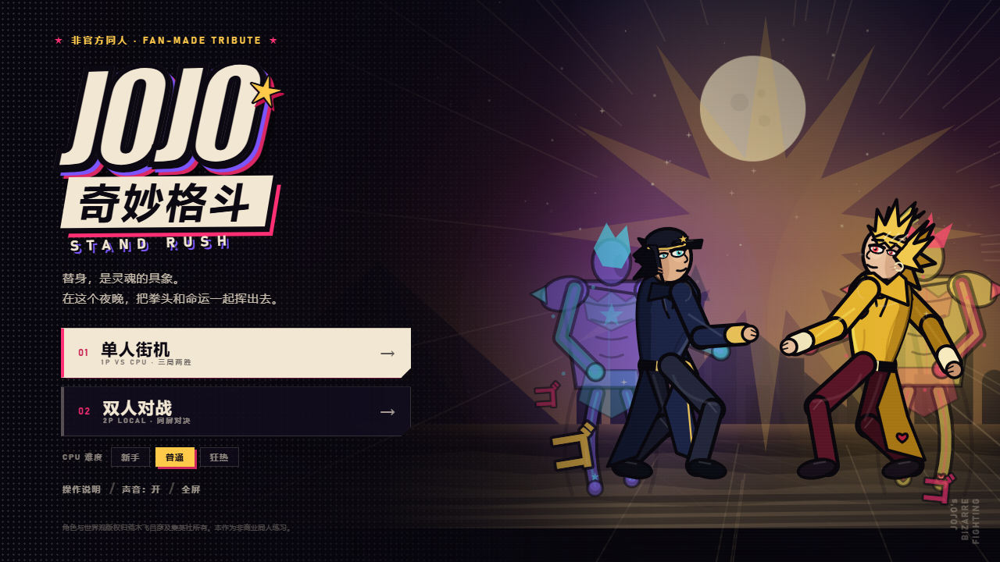
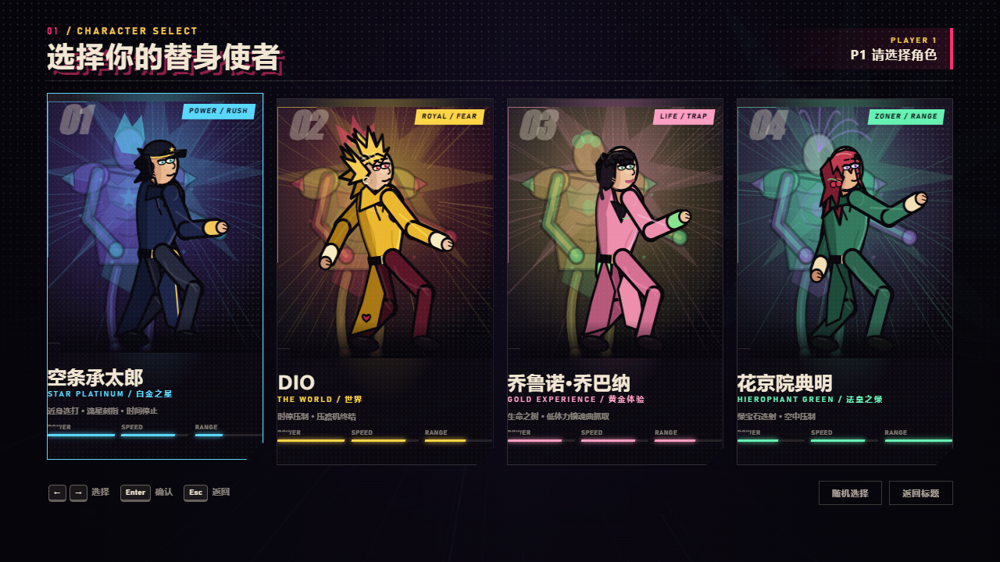
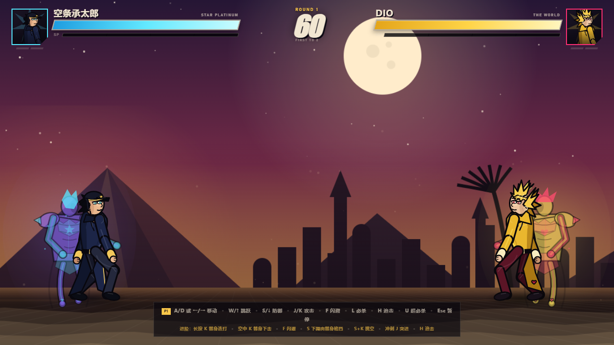
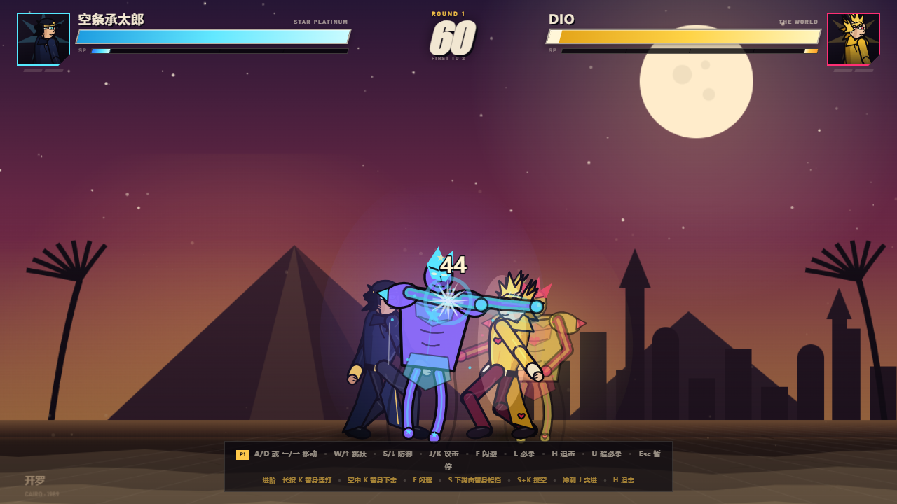
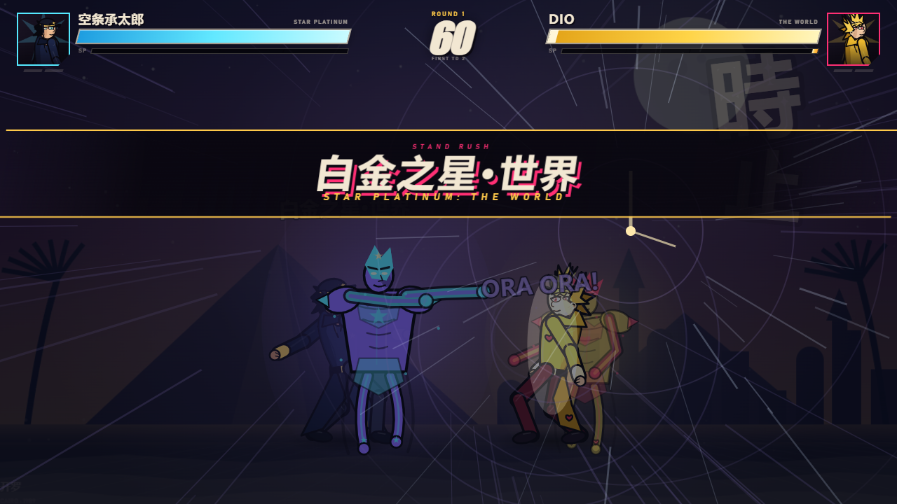

# JOJO 奇妙格斗 · STAND RUSH

一款无需安装、打开即玩的横版 2D 网页格斗游戏。六位替身使者、三张舞台、1P 对 CPU、本地双人对战与联机对战（在线 / 局域网）。角色、替身与头像采用卡通矢量 Canvas 渲染，特效由 Canvas 程序化生成，音频由 Web Audio 实时合成；只有终结演出可选读取 `assets/finishers/` 下的角色参考图，其余素材没有外部图片或音频依赖。



非官方同人练习作品。角色与世界观版权归荒木飞吕彦及集英社所有，请勿用于商业用途。

**在线试玩：<https://jojo.bigcow.net/>**  
**源代码：<https://github.com/zhuguangjun2002/jojo-stand-rush>**

> 线上版由 Cloudflare Pages 托管页面，Cloudflare Worker + Durable Objects 中转房间和输入。人机对战、本地双人、训练场和**跨网络在线联机**都可以直接玩；项目里的 `server.py` 仍然用于本地局域网联机。

## 界面预览

| 选人 | 战斗 |
| --- | --- |
|  |  |





## 卡通矢量美术

- 角色与替身使用可动骨骼式矢量绘制，依靠平滑轮廓、分段阴影和高光表现动漫质感。
- HUD 头像、选人立绘、标题画面与战斗角色共用同一套角色绘制与动画管线。
- 替身保留当前造型与攻击动作，普通攻击、连打、格挡和空中下击都在本体前方完成。
- 新增角色会自动继承这套卡通渲染，不需要单独维护两套绘制逻辑。

## 立刻开始

- **Linux / macOS（当前开发环境：Linux Mint）**：在项目目录运行 `./run.sh`，默认打开 `http://127.0.0.1:8080/`。
- **Windows**：双击 `启动游戏.bat` 可直接打开 `index.html`；需要本地服务器时双击 `启动服务器.bat`。
- 也可以直接双击 / 用浏览器打开 `index.html`，这种方式不需要服务器。
- 需要通过 URL 访问时，先运行 `./run.sh`（Linux）或 `启动服务器.bat`（Windows），它会启动本地服务并打开浏览器。
- 服务器带有**无观众立即退出**：页面可见时每 3 秒发送一次心跳；关闭标签页或切到后台时会发送退出信标，最后一个观众离开后约 2 秒关闭进程。需要长期驻留（例如局域网分享）时加 `--no-autoclose`。
- 刷新页面会在这 2 秒内用新的心跳取消关闭，不会被误关。
- 关闭浏览器标签页后无需手动关服务器；下次要玩时再次启动服务器即可。

### 在 Linux / macOS / WSL 下启动

```bash
./run.sh                 # 默认 127.0.0.1:8080；Linux 用 xdg-open，WSL 下用 Windows 浏览器
PORT=9000 ./run.sh       # 换端口
HOST=0.0.0.0 ./run.sh    # 允许同一局域网内的其他设备访问
./run.sh --no-autoclose  # 关掉“没人看就退出”，用 Ctrl+C 停止
```

`HOST` / `PORT` / `IDLE` / `PYTHON` 都可用环境变量覆盖；`OPEN_BROWSER=0` 可禁止自动开浏览器。`make run` 是同一套逻辑的快捷方式，但需要先安装 `make`。

首次点击页面后音频才会启动，这是浏览器的自动播放限制。

## 联机对战

游戏有两种联机方式，界面和操作完全一样，只是房间中继不同：

- **在线联机**：打开 <https://jojo.bigcow.net/>，通过 Cloudflare Worker + Durable Objects 中继；双方可以在不同网络。
- **局域网联机**：在本机运行 `server.py`，双方连接同一局域网；不需要互联网或额外账号。

### 在线联机（推荐）

1. 双方打开 <https://jojo.bigcow.net/>。
2. 房主点「联机对战」→「创建房间」，把生成的 4 位房间码告诉对方。
3. 对方点「联机对战」→ 输入房间码 →「加入」。
4. 双方各自选角，两人都选好后自动开始。

在线中继只转发房间控制消息和输入帧，战斗逻辑仍在两台浏览器本地运行。房间码要等房间创建成功后再复制；如果连接失败，刷新页面重试即可。

在线模式默认使用 **12 帧输入延迟**（约 200ms）来抵消网络往返，避免锁步等待导致双方掉帧。网络很好时可以调低 `js/config.js` 里的 `onlineInputDelay`；延迟高时可以调到 15–20 帧。

### 局域网联机

两台设备连接同一局域网即可，不需要互联网或额外账号。

#### 房主

```bash
HOST=0.0.0.0 ./run.sh
```

Windows 下也可以直接双击 `启动局域网服务器.bat`，或在项目目录打开命令提示符：

```bat
python server.py --host 0.0.0.0 --open
```

然后让另一台设备用 **房主的局域网 IP:端口** 打开游戏，例如 `http://192.168.1.20:8080/`。

#### 开始对战

1. 双方打开同一个游戏地址。
2. 房主点「联机对战」→「创建房间」，系统会自动生成 4 位房间码，把它告诉对方。
3. 对方点「联机对战」→ 输入这个房间码 →「加入」；不要自己编房间码。
4. 双方各自选择自己的角色。
5. 两人都选好后自动开始。

- 联机双方都使用本地 P1 键位：`A/D` 移动、`Space` 跳、`S` 防、`J/K` 攻击、`L` 二技能、`H` 追击、`F` 闪避、`U` 超必杀。
- 方向键和 `1/2/3/5/4` 也作为兼容键保留，双方都可以用。
- 联机采用锁步同步：双方每帧交换输入后再推进模拟，因此两边看到的血量、位置和判定一致。
- 如果一方卡住，游戏会等另一方；局域网内通常延迟很低。
- 联机模式不启用 CPU，也不支持训练场。
- 如果界面显示 `127.0.0.1`，说明服务器只监听了本机；请用 `HOST=0.0.0.0` 重启，并让另一台设备使用房主的局域网 IP。
- 如果服务器运行在 WSL 里，Windows 侧访问 `127.0.0.1` 可能正常，但同一局域网的其他设备不一定能直接访问 WSL 地址。跨设备联机建议在 Windows 项目目录双击 `启动局域网服务器.bat`，或自行配置 WSL 端口转发。

### WSL2 下第二台设备访问不了

> 以下内容是项目早期 Windows + WSL2 环境的记录。当前维护环境是 Linux Mint，直接 `HOST=0.0.0.0 ./run.sh` 即可，不需要端口转发。

WSL2 默认是 NAT 网络。`HOST=0.0.0.0 ./run.sh` 只监听 WSL 内部，例如 `172.26.32.253:8080`；第二台设备需要访问的是 **Windows 的局域网 IP**，例如 `192.168.50.176:8080`，两者之间需要端口转发。

最简单的两种做法：

1. **推荐：在 Windows 侧启动服务器**
   - 在 Windows 文件资源管理器打开项目目录。WSL 发行版名不一定是 `Ubuntu`，例如本机是 `Ubuntu-26.04`：
     `\\wsl.localhost\<发行版名>\<项目目录>`。也可以在 WSL 里执行 `explorer.exe .` 直接打开。
   - 双击 `启动局域网服务器.bat`。
   - 如果 Windows 弹出防火墙提示，允许 Python / 专用网络访问。
   - 对方访问 `http://Windows局域网IP:8080/`。

2. **继续在 WSL 里启动服务器**
   - 保持 `HOST=0.0.0.0 ./run.sh` 运行。
   - 在 Windows 双击 `局域网端口转发.bat`，按提示以管理员身份运行。
   - 脚本会把 Windows `8080` 转发到当前 WSL IP，并添加防火墙规则。
   - 对方访问 `http://Windows局域网IP:8080/`。
   - WSL 重启后 IP 会变化，需要重新运行一次脚本。

手动配置端口转发（管理员 PowerShell）：

```powershell
# 先查 WSL IP
wsl hostname -I

# 假设 WSL IP 是 172.26.32.253
netsh interface portproxy add v4tov4 listenaddress=0.0.0.0 listenport=8080 connectaddress=172.26.32.253 connectport=8080

# 放行 Windows 防火墙 8080
New-NetFirewallRule -DisplayName "JOJO LAN 8080" -Direction Inbound -Protocol TCP -LocalPort 8080 -Action Allow
```

另外检查：

- 两台设备是否在同一 Wi-Fi / 同一网段。
- Windows 网络是否被识别为「公用网络」；公用网络下防火墙更容易拦截入站。
- 路由器是否开启了 AP 隔离 / 访客网络隔离。
- Radmin VPN 等虚拟网卡可能造成路由混乱，建议联机时先断开。

## 在线部署（Cloudflare Pages + Workers）

线上版由两部分组成：

1. **Cloudflare Pages**：托管 `index.html`、`styles.css`、`js/`、`assets/`、`voices/` 和 `screenshots/`。
2. **Cloudflare Worker + Durable Objects**：`worker/` 中的 `jojo-stand-rush-ws` 负责房间和输入帧中继，域名 `ws.jojo.bigcow.net`。

浏览器在本地 `./run.sh` 环境下优先使用同源 `/__ws`；在静态部署下自动改用 `js/config.js` 里的 `wss://ws.jojo.bigcow.net/__ws`。静态页面不会反复请求不存在的 `/__heartbeat`。

- 当前生产地址：<https://jojo.bigcow.net/>
- Cloudflare Pages 项目：`jojo-stand-rush`
- 自定义域名：`jojo.bigcow.net`（CNAME → `jojo-stand-rush.pages.dev`，已开启代理）
- 联机中继：`jojo-stand-rush-ws`（`ws.jojo.bigcow.net`）

手动部署（需要 `CLOUDFLARE_API_TOKEN`）：

```bash
STAGE=/tmp/jojo-pages
rm -rf "$STAGE" && mkdir -p "$STAGE"
cp index.html styles.css "$STAGE"/
cp -r js assets voices screenshots "$STAGE"/
npx wrangler@latest pages deploy "$STAGE" \
  --project-name jojo-stand-rush \
  --branch main \
  --commit-dirty=true

cd worker
npx wrangler@latest deploy
```

仓库内的 GitHub Actions 工作流 `.github/workflows/deploy-cloudflare.yml` 会在 `main` 分支更新后自动发布 Pages 和 Worker。首次使用前在 GitHub 仓库的 **Settings → Secrets and variables → Actions** 中添加：

- `CLOUDFLARE_API_TOKEN`：需要 Pages 编辑、Workers Scripts 编辑、Durable Objects 编辑权限
- `CLOUDFLARE_ACCOUNT_ID`：Cloudflare 账户 ID

自定义域名需要在 Cloudflare 中保持有效：`jojo.bigcow.net` 指向 Pages，`ws.jojo.bigcow.net` 指向 Worker。

## 训练场

标题菜单选「训练场」（数字键 `3`）→ 选角色 → 选训练假人。

- 无限 HP / SP，没有回合倒计时，也不会触发 KO；可以一直练连段和超必杀。
- 假人默认站立，不会主动攻击。按 `T` 或点训练面板里的「假人防御」，让它进入格挡状态。
- 按 `R` 或点面板里的「重置」，把双方位置、血量、能量和场上残留效果清空。
- 训练面板在右下角显示假人状态和快捷键；触屏设备会自动移到右上角，避免挡住攻击键。

## 人机对战

标题菜单选「人机对战」→ 选 P1 → 选 CPU 角色。

- 「CPU 难度」提供新手 / 普通 / 狂热，以及「自定义」。
- 自定义可调：反应速度、进攻欲望、防御倾向、伤害倍率、脱身概率；修改立即生效并自动保存。
- AI 会感知对手的攻击、连打和飞行物，并按难度延迟格挡、跳躲或闪避。
- AI 会惩罚出招硬直、用挑空技对空、在有效距离使用 H/L 技能，并通过进退走位保持自己的优势距离。
- 难度越高，反应窗口越短、格挡率越高，也越容易在攻击启动帧完成格挡/反击。

## 操作

| 动作 | P1 | P2 |
| --- | --- | --- |
| 移动 | `A` / `D` | `←` / `→` |
| 跳跃 | `Space` | `↑` |
| 防御 / 下蹲 | `S` | `↓` |
| 轻攻击 | `J` | `1`（小键盘 `1`） |
| 重攻击 | `K` | `2`（小键盘 `2`） |
| 二技能（消耗因角色而异，CD 8 秒） | `L` | `3`（小键盘 `3`） |
| 追击技（20–25 SP，CD 5 秒） | `H` | `5`（小键盘 `5`） |
| 超必杀（100 SP） | `U` | `4` / 小键盘 `0` |
| 闪避 / 受击脱离 | `F` | 右 `Shift` |
| 暂停 | `Esc` | — |
| 静音 | `M` | — |

- **单人模式**下，P1 也可以直接用方向键移动 / 跳跃 / 防御，并用 `1` `2` `3` `4` `5` 出招；跳跃用 `Space`（方向键 `↑` 也可）。
- 透龙的能量消耗例外：`K` 1 SP，`H` 短按 10 / 长按 25 SP，`L` 50 SP，`U` 50 SP。
- 东方定助的能量消耗例外：`H` 20 SP，`L` 泡沫弹免费（3 发 / 4 秒冷却）；进化需要 U 达到 150 能量（100 SP + 50 特殊能量），进化后 `L` 变为 40 SP 的超越泡泡、`U` 为 100 SP 超必杀。
- 标题画面的「CPU 难度」支持新手 / 普通 / 狂热，以及「自定义」：可分别调整 CPU 反应速度、进攻欲望、防御倾向、伤害倍率和脱身概率，设置会自动保存。
- 标题页的「按键设置」可以分别修改 P1 / P2 的移动、跳跃、防御、攻击、技能、超必杀和闪避按键；点击按键后按下新键即可，自动保存，也可一键恢复默认。联机对战时双方都使用 P1 键位。
- 手机/触屏设备在标题页有「触屏设置」：可以在局外直接拖动虚拟按键、调整大小、重置布局，不需要先进战斗暂停。按键设置页里也有「触屏布局」入口。
- 跳跃有 0.18 秒输入缓冲；按住 `A` / `D`（或方向键）时按跳跃键会优先起跳，并保留移动惯性。
- **直接朝向**：玩家按 `A` / `←` 会立刻面向左侧，按 `D` / `→` 面向右侧；没有方向输入时才自动面向对手。AI 仍保持自动面向。
- 双击同一方向可以冲刺。
- 双击反方向是后撤步，带有短暂无敌帧和残影；后撤时镜头与替身都会跟着移动。
- 轻攻击命中后继续按轻/重攻击可以衔接连段，最多三连。普通攻击命中不会把对手横向推开，因此 **J → K** 等轻 / 重衔接可以稳定连上；必杀、投技和飞行物仍保留击退。
- `J` 轻攻击的拳位判定比 `K` 重击略长一点，适合远距离起手；`K` 的伤害和硬直更高。
- **跳跃取消**：普通攻击（J、短按 K、挑空、冲刺攻击）中按 `Space` 可以立刻取消攻击并起跳；长按 K 连打中按 `Space` 也会直接打断连打并起跳；H 和必杀不会被跳跃取消。
- **长按 `K` / `2`**：替身会在本体身前持续连打；花京院会连续发射绿宝石。连打期间可用 `A` / `D`（或左右方向键）控制前进后退，不再自动向前冲。
- **普通 J / 短按 K / 挑空 / 空中攻击**：每次出招都会触发一次对应角色的短战吼；长按 K 则持续循环到连打结束。
- **空中按 `J` 或 `K`**：替身向下发动不可防御的坠击，命中后打破防御。
- **下蹲 / 防御**：替身会站到本体前方替身格挡，本体在后方保持低姿态。
- **`F` / 右 `Shift`**：向当前方向或后方快速闪避，带短暂无敌。
- **受击脱离**：被连段命中时按 `F`，消耗 25 能量脱离连段，自身获得 **1 秒无敌**；无敌期间角色略微半透明，便于分辨。脱身不会推开、打断或眩晕对手。冷却 10 秒；U 演出期间不可脱离。普通状态闪避不耗能，也不会触发这 10 秒冷却。
- **完美闪避**：在对手攻击启动的瞬间按 `F`，会获得 0.9 秒反击窗口，并进入 5 秒完美闪避冷却；窗口内按 `J` 免费发动 H，再自动追加一次替身追击。
- **AI 受击脱离**：CPU 在连段中也会根据难度尝试消耗 25 SP 脱离，冷却同样为 10 秒。
- **下 + 重击**：挑空技，把对手打上空中。
- **冲刺中按轻击**：突进攻击，带残影并快速拉近距离。
- 防御会吃少量削血；防御硬直结束后可以立刻反击。
- **替身对拳（STAND CLASH）**：双方近距离同时长按 `K` / `2` 会进入对拳。快速连按 `K` / `2`，先到 **50 次** 的一方获胜，对手直接损失 **30% 最大生命值**。长按 `F` / 右 `Shift` **0.75 秒** 可消耗 **50 SP** 脱离对拳，双方都不掉血。
- 普通攻击的判定现在跟随替身拳头：从角色身体到拳头之间都有判定，受击判定仍然是角色本体。
- 开局 SP 为 **50**，上限 100；L 需要 80（乔鲁诺 40；东方定助泡沫弹免费，进化后超越泡泡 40），U 需要 100。J 命中 **+5**，短按 K 命中 **+8**，长按 K 每段 +1；H 消耗 20–25；L/U 命中不回复能量；被击或防御不增加也不扣除普通 SP。东方定助每次被命中 +2 特殊能量；普通攻击 / 技能正常获得普通 SP，并把其中的 50%（向下取整）转化为特殊能量。
- **技能冷却**：H 冷却 **5 秒**，L 冷却 **8 秒**，成功发动后开始计时；东方定助 L 为 3 发泡沫弹，3 发后 4 秒冷却；进化后 L 恢复 8 秒冷却。冷却中按键会提示剩余时间。
- 2P 模式需要键盘；手机端会显示 P1 的虚拟轮盘和攻击键。

### 手机 / 平板

- 请使用**横屏**。竖屏时会显示「请横屏游玩」，转回横屏后游戏区域会自动重新居中。
- 触屏操作：左下是虚拟轮盘——左右拖动移动，**上拉跳跃**，**下拉防御**；右侧是 `轻 重 技 追 闪 极`，底部中间的 `Ⅱ` 是暂停键。触屏按钮按屏幕像素渲染，不会跟着 1280×720 画布一起缩小。
- 暂停菜单里可以直接切换声音和全屏；浏览器支持时，进入全屏后会尝试锁定横屏。iOS Safari 不支持网页全屏，可以「添加到主屏幕」后以独立窗口游玩。
- 触屏支持多指同时操作：推住轮盘移动或防御的同时可以连按攻击键，长按 `重` / `技` 也会保持按住状态。
- **自定义按键**：暂停 →「自定义按键」，或直接点底部暂停键上方的 `⚙`。点选轮盘或右侧攻击键后可以拖动位置，并用滑杆或 `−` / `+` 调整大小（70%–160%）。位置与大小自动保存，点「重置」恢复默认；布局会按屏幕比例保存，旋转、全屏或窗口尺寸变化后会重新应用。
- 手机适合人机对战、训练场和联机对战；同屏双人对战（2P）仍然需要键盘。
- 页面切到后台时游戏循环和音频会暂停，回到页面后继续。

## 规则

- 双方基础 HP 为 **2000**，三局两胜，每回合 60 秒。
- 角色之间没有身体碰撞，可以互相穿过走位；攻击判定仍然正常。
- 时间耗尽时按剩余体力判定；双方体力相同则该回合平局。
- 超必杀为不可打断的演出，演出期间计时暂停。
- 承太郎 `U` 会停止时间；DIO 的 `L` 是短时停，`U` 是「压路机」终结技。
- 乔鲁诺体力低于 25% 时，U 会变为「黄金体验镇魂曲」前冲抓取；抓空会清空 SP。
- 所有角色的普通攻击、必杀和空中攻击都由替身在前方执行。

### 替身对拳（STAND CLASH）

1. 双方在约 **185px** 内同时按住 `K` / `2`，或同时进入近身长按 K 连打。
2. 画面暂停并出现对拳面板，双方快速连按 `K` / `2`。
3. 先到 **50 次** 的一方获胜，败者直接损失 **30% 最大生命值**（2000 HP 时为 600）。
4. 对拳中长按 `F` / 右 `Shift` **0.75 秒**，消耗 **50 SP** 脱离；脱离成功双方都不掉血。
5. 12 秒内无人到 50 次判 DRAW。花京院长按 K 为绿宝石连射，不参与对拳。

## 角色

| 角色 | 替身 | 打法 |
| --- | --- | --- |
| 空条承太郎 | 白金之星 | 长按 K 欧拉连打；H 流星刺指（命中后追击一拳）；L 星光突进；U 时间停止 |
| DIO | 世界 | 长按 K 木大连打；H 时停绕后袭击；L 短时停；U 压路机 |
| 乔鲁诺·乔巴纳 | 黄金体验 | 长按 K 木大连打；H 短按青蛙 / 长按生命之树；L 生命之藤；低体力 U 镇魂曲抓取 |
| 花京院典明 | 法皇之绿 | 长按 K 绿宝石连射；H 绿宝石飞溅；L 绿宝石水花；U 20 米绿宝石风暴 |
| 透龙 | 奇迹与你 | J 拐杖敲击；K 3 发石头（3 发后 5 秒冷却，冷却中短 K 为短拐击）/ 长按抓取；H 灾厄洪流 / 长按追击之雨；L 枯木虫；U 灾厄的恶领域 |
| 东方定助 | 软又湿 / 软又湿·超越 | H 夺走之泡随机偷取属性；L 3 发普通泡沫弹；U 蓄满 150 能量进化；进化后 L 超越泡泡、U 穿透爆裂泡泡（夺取全属性 6 秒），攻击不再触发奇迹与你的灾厄 |

### 乔鲁诺 · 黄金体验镇魂曲

体力低于 **25%** 且 SP 为 **100** 时，按 `U`：

1. 乔鲁诺向前冲刺一小段距离并抓取对手。
2. **只有抓到**才会播放黄金体验镇魂曲觉醒演出，进入镇魂曲形态（延续到后续回合），并发动「无法到达的真实」直接清空对手体力。
3. **抓空或被对手躲开**：不会变身，SP 立刻清零，并进入短暂硬直。
4. 常态 `H`：**短按**召唤一只生命青蛙在场地内徘徊；**长按 0.34 秒**生成「生命之树」站上去，短暂无敌并持续回血。镇魂曲形态下 `H` 为「归零射线」：不可防御。
5. 青蛙本身不攻击，但对手的攻击 / 飞行物打到青蛙时，乔鲁诺会直接扣除对手 **当前最大生命值的 5%**，并造成 **2 秒僵直**；如果青蛙直到消失都没被碰过，则返还这次召唤消耗的 25 SP。
6. `L` 的「生命之藤」现在是普通二技能：40 SP、48 伤害、可防御，冷却 8 秒，不再按终结技处理。

抓取可以穿过普通防御，但会被跳跃、后撤或攻击打断。

### 透龙 · 奇迹与你

透龙本体通常不出场，画面中战斗的是从墙壁中穿出的「奇迹与你」。它使用深色大衣、礼帽、拐杖和发光的眼睛作为主要轮廓，身高缩放后与其他角色接近，移动时会拄着拐杖迈步。

- `F`：原地消失，向后瞬移约 220px；受击脱离也改为向后瞬移约 200px，不再出现在对手身后。
- 双击 `A` / `D`：向左 / 右瞬移 240px。
- `J`：拐杖敲击，后摇较长；判定距离已缩短（比常规 J 更近），不发出战吼。
- `K`：丢出石头「OB-LA-DI-OB-LA-DA」，石头在地下潜行、接近对手时跳出命中；命中后对手身上布满石头并回复 **15 SP**。短 K **不消耗 SP**，未命中会在一定距离后消失。石头射程已从约 620px 下调到 **500px**，命中范围与命中僵直也略微降低。每连续丢出 **3 颗** 石头后进入 **5 秒冷却**；冷却期间短 K 变为距离更短的拐击（动作与 J 相同，但判定更近）。石头和枯木虫都是贴地判定，跳跃可以躲开；两者只朝施放方向直线移动，不会中途转向。
- 5 秒内连续用石头命中 5 次，会额外触发一次 **120 伤害的灾厄爆炸**。
- 长按 `K`：向前瞬移约 190px 抓取；路径上碰到对手就触发灾厄丢飞，未命中也仍会完成这段瞬移。抓取是**高优先级指令投**，可以抓到防御中的敌人并破除防御；前冲有短暂无敌，不容易被普通攻击打断。继续按住 K 且 SP 足够时，会瞬移到对手面前重复抓取，最多 6 次。
- `H`（10 SP）：灾厄的洪流。奇迹与你发出红光并进入灾厄姿态；此时敌人打中它不会扣血，而会被突然掉下的汽车 / 桌子 / 椅子砸飞。
- 长按 `H`（25 SP）：后撤并在前方小范围触发追击之雨。命中后敌人被冻结 **2.4 秒**，每秒受到 20 伤害；期间不可脱离。
- `L`（50 SP）：召唤枯木虫「Da-Da-Da-Da-Da-Da-Da」，沿施放方向直线移动，不会转向；触碰敌人后触发虫群攻击。
- `U`（50 SP）：开启「灾厄的恶」领域，持续 20 秒。期间受到的伤害降低 30%，对敌人伤害提高 20%，被攻击时有 **40%** 概率触发灾厄反击。领域随机掉落的物体伤害已下调，只做削血和干扰，不会打断对手动作；短按 H 的灾厄姿态反击仍然是完整高伤害反击。
- 跳跃中按 `J` 使用拐杖攻击，可破防；按 `K` 丢出石头。
- 奇迹与你造成的所有命中僵直与「追击之雨」冻结时间都缩短为 **0.8 倍**；短按 H 灾厄姿态的 1.15 秒反击僵直同样按此比例缩短。
- 终结台词：「我已经告诉过你要住手了.......」

> 终结演出图已接入 `assets/finishers/tooru.png`；如果之后替换这张图，会直接使用新图。

### 东方定助 · 软又湿 / 软又湿·超越

东方定助使用白色水手服、水手帽、绿色星形徽章和深绿色短发；替身「软又湿」是白色/浅蓝色的人形，胸口有深紫色船锚，肩上有金色星星。

- **J / K / 空中攻击**：常规近身攻击与替身坠击，动作模板与其他角色一致。
- **H（20 SP）· 夺走之泡**：向前发射一颗缓慢漂浮的泡泡。泡泡命中未防御的对手时，随机夺走一项属性，持续 **8 秒**（超越后 **10 秒**）：
  - **力量**：定助伤害 +15%，对手伤害 -15%。
  - **速度**：定助移动速度 +15%，对手移动速度 -18%。
  - **防御**：定助受到伤害 -12%，对手受到伤害 +12%。
  - **SP**：直接从对手身上夺走 **20 SP** 加给自己。
- **L（0 SP）· 泡沫弹**：发射普通远程泡泡，28 伤害、可防御，不偷取属性。拥有 **3 发** 弹药，3 发后进入 **4 秒冷却**，冷却结束自动补满。
- **特殊能量（0–50）**：定助被命中时 **+2**；所有普通 SP 获取的 **50%（向下取整）** 也会转化为特殊能量（轻击 5 → +2，重击 8 → +4，夺 SP 20 → +10）。HUD 在主 SP 条右侧显示一条独立的 50 点特殊能量条。
- **U · 进化**：普通 SP **100** + 特殊能量 **50**（总计 150）时按 U，消耗全部能量进化为「软又湿·超越」，持续整场对战并跨回合保留。进化后 U 恢复为 100 SP 的穿透爆裂超必杀。
- **进化后 L（40 SP）· 超越泡泡**：发射高速、不可防御的大泡泡，造成 74 伤害并带破防。
- **进化后 U（100 SP）· 软又湿·超越**：向前射出必杀泡泡；泡泡命中后径直穿过对手身体，随后对手爆开，造成 320 伤害。同时夺取目标所有可偷取属性（力量 / 速度 / 防御）**6 秒**，额外夺走 20 SP；若目标是奇迹与你，还会封印其石头与枯木虫能力 **6 秒**（长按 K 的前冲抓取不受影响）。
- **关键被动**：进化后，东方定助的所有攻击（包括泡泡、普通攻击和超越泡泡）都不会触发奇迹与你的灾厄姿态反击，也不会触发「灾厄的恶」领域的概率反击。这是还原定助击败透龙的关键机制。

> 终结演出图已接入 `assets/finishers/josuke.jpg`；如果之后替换这张图，会直接使用新图。

### 追击技（H / 5）

正常发动消耗 25 SP，冷却 5 秒；完美闪避后的反击窗口内按 `J` 可免费发动，并追加一次替身追击。

| 角色 | 技能 | 效果 |
| --- | --- | --- |
| 空条承太郎 | 流星刺指 | 流星状星光突刺；射程略微缩短，命中后瞬移到对手面前追加一拳；跳跃可以躲开 |
| DIO | 时停·绕后袭击 | 短暂时停，瞬移到对手背后并打出不可防御的一击 |
| 乔鲁诺 | 生命青蛙 / 生命之树 / 归零射线 | 短按召唤青蛙骚扰；长按生成生命之树无敌回血；镇魂曲形态下变为不可防御的归零射线 |
| 花京院 | 绿宝石飞溅 | 七发扇形绿宝石 |
| 东方定助 | 夺走之泡 | 缓慢泡泡，命中后随机偷取力量 / 速度 / 防御 / SP，持续 8 秒（超越后 10 秒）；进化后同样不会触发灾厄 |

## 文件结构

```text
index.html          页面与 UI（含触屏轮盘与 HUD）
styles.css          标题、选人、HUD、结算、触屏控件与响应式样式
js/data.js          角色、招式、舞台与难度数据
js/audio.js         合成音效与循环配乐
js/art.js           舞台、角色、替身、拳位计算、肖像与漫画特效
js/game/core.js     共享作用域：常量、DOM、输入映射、HUD、AI 决策与界面切换
js/game/fighter.js  角色状态机：移动、出招、受击与替身拳位判定
js/game/match.js    回合、镜头、判定、训练模式与替身对拳
js/game/supers.js   超必杀、终结演出等纯绘制覆盖层
js/game/render.js   按当前界面分发渲染
js/game/main.js     键盘 / 触屏输入、自定义按键布局、心跳、主循环与启动
js/net.js           联机房间客户端、锁步输入与 WebSocket 消息
js/config.js        部署配置：静态站使用的在线中继地址
worker/             Cloudflare Worker + Durable Object 在线房间中继
assets/finishers/   终结演出角色图（可选，承太郎 / DIO / 乔鲁诺 / 花京院 / 透龙 / 东方定助）
voices/             可选语音包目录（含 VOICEVOX 台词、透龙的 tooru_*.mp3/.wav 与定助的 josuke_*.mp3）
server.py           本地服务器：静态文件、观众心跳、局域网房间与 WebSocket 中继
.github/workflows/deploy-cloudflare.yml  推送 main 后自动发布 Pages 与 Worker
启动游戏.bat        直接打开 index.html
启动服务器.bat      启动本地 URL 服务并打开浏览器
启动局域网服务器.bat 监听 0.0.0.0，供同一局域网的其他设备联机
局域网端口转发.bat  WSL2 下把 Windows 局域网端口转发到 WSL 服务器
TESTING.md          自动化测试说明与 WSLg GPU 测试安全规则
HANDOVER.md         交接文档：当前机制、平衡、测试、已知限制与后续建议
```

## 实现要点

- 固定 1280×720 逻辑分辨率，根据窗口等比缩放；画布 DPR 上限 1.25，渲染上限约 100 FPS。
- 战斗场地宽 2000px，镜头会跟随双方位置横移，并在拉开距离时自动缩小以保持两人同屏。
- 三张舞台都向右侧扩展了街区、废墟、绿洲与霓虹店铺，横向移动不会看到空白边界。
- 静态舞台预渲染到离屏画布，HUD 使用脏值更新，避免每帧重复绘制与 DOM 写入。
- 页面切到后台或关闭时暂停游戏循环并挂起音频；重新打开页面后才继续运行。
- 页面可见时每 3 秒向本地服务器发送一次心跳；关闭/隐藏页面时发送 `/__bye` 信标，最后一个观众离开后约 2 秒服务器自动退出，避免无人使用时长期占用后台进程。
- 60Hz 固定步长物理，带移动加减速、输入缓冲、受击硬直、命中停顿、屏幕震动与连段伤害递减。
- 角色采用可动骨骼式矢量绘制，髋部/胸部反向摆动、衣摆 flutter、跳跃拉伸、落地压缩与受击抖动都保留在平滑的卡通动画里。
- 走路循环频率会随移动速度变化，髋部、胸部、头部、四肢和衣摆使用不同的跟随阻尼；落地会屈膝缓冲，急转身会有重心倾斜，减少“滑步”和机械感。
- 替身有自己的跟随延迟、行走摆臂、后撤倾斜和攻击前移，不再固定在角色背后的单一坐标；替身与角色共用同一套矢量轮廓和阴影色。
- 普通攻击、必杀、超必杀、长按 K 连打、空中攻击和下蹲格挡都由替身在本体前方执行，本体只做指挥、重心支撑和闪避。
- 普通攻击判定锚定在替身拳头的实际绘制位置，判定覆盖从身体到拳头的整段距离；受击判定仍然使用角色本体。
- STAND CLASH 是独立于普通战斗的暂停式小游戏：双方按住 K 触发，连按计数到 50，败者扣 30% 最大生命值；F 长按消耗 50 SP 可脱离。
- AI 使用威胁感知、反应延迟、格挡/跳躲/闪避、硬直惩罚、对空、连段计划、技能射程检查和进退走位；难度和自定义参数直接驱动这些数值。
- 联机由 WebSocket 房间中继输入，双方按帧锁步推进；本地 `server.py` 负责局域网，Cloudflare Worker + Durable Objects 负责在线。影响玩法的随机（青蛙游走）使用共享 seed，纯视觉随机仍由各客户端本地生成。
- 长按 K / 2 会先出重击，随后自动衔接替身连打；花京院为绿宝石连射。
- 用超必杀终结对手、或在赛点 KO 时会进入约 3 秒的处刑演出：镜头拉近、上下黑边、KO 冲击，叠放对应角色的终结参考图，并在画面底部显示终结台词（承太郎「闭嘴，你这家伙」、DIO「The World」、乔鲁诺「我乔鲁诺.乔巴拿更想要成为【黑帮巨星】」、花京院「接招吧，半径20米的绿宝石水花」、东方定助「泡沫，会夺走一切」）。
- 胜负结算带角色专属演出：承太郎抬手压帽 / 被切成干净的两半，DIO 仰头狂笑 / 碎成一块块，乔鲁诺扯衣领 / 倒在地上，花京院伸手指向对手嘲讽 / 胸口出现一个无血腥的圆形空洞后倒下。
- 替身、能量、花瓣、沙尘、时间停止、速度线、半调网点均由 Canvas 程序化生成。
- ORA / MUDA / ZA WARUDO / ROAD ROLLER 等战吼读取 `voices/*.mp3`；本版用 VOICEVOX 合成角色台词，青山龍星、玄野武宏、白上虎太郎、剣崎雌雄分别对应承太郎、DIO、乔鲁诺、花京院；透龙使用青山龍星降调，东方定助使用玄野武宏。长按 K 用短句循环到技能结束。不是原版声优，署名见 `voices/VOICEVOX-CREDITS.txt`；缺失文件时才回退到浏览器 SpeechSynthesis。
- 战斗音效采用多层实时合成：拳击由高频点击、低频冲击、中频破裂和短尾音叠加，连打使用独立轻量版本；另有压缩器、金属格挡、破防碎裂、时停时钟与反向上升音、压路机柴油/金属/落地冲击等，可直接静音。
- BGM 也是原创实时合成：菜单 92 BPM 稀疏循环，战斗 138 BPM，加入更密的底鼓、贝斯、铜管短促和弦与低音合唱铺底；标题、选人、战斗和结算会自动切换，不依赖外部音乐文件。
- 手机舞台按 `visualViewport` 等比缩放并始终居中；触屏控件放在缩放舞台之外，按屏幕像素渲染并适配安全区。左下虚拟轮盘与右侧攻击键共享同一套输入映射，左/右/上/下分别映射移动、跳跃和防御。
- 触屏布局编辑器把轮盘和攻击键的位移按视口比例、缩放按 70%–160% 写入 `localStorage`；编辑期间暂停游戏并拦截按键输入，只响应选中、拖拽和尺寸滑杆。恢复布局时会重新应用，并在当前可视区内做边界夹取。

## 已知说明

- 本项目是粉丝向练习作品，不是官方游戏，也不会分发任何官方素材。
- `assets/finishers/` 的角色参考图由用户提供，版权归原作者；仅用于本地非商业同人演示。透龙的终结图位于 `assets/finishers/tooru.png`，东方定助的终结图位于 `assets/finishers/josuke.jpg`。
- 胜负演出全部是程序化绘制，不含血腥画面。
- 桌面端推荐 16:9 窗口；手机请横屏，触屏按键会自动出现。
- 如果浏览器阻止音频，点击任意按钮后会正常开始。

## 更新记录

### 2026-11-16

- 东方定助最终机制：`H` 夺走之泡随机偷取属性；`L` 改为 3 发普通泡沫弹（3 发后 4 秒冷却）；被命中时 +2 特殊能量，普通 SP 获取的 50% 也会转化为特殊能量；普通 SP 100 + 特殊能量 50 时按 `U` 进化。
- 东方定助去掉胡渣；HUD 在主 SP 条右侧新增 50 点特殊能量条，进化后隐藏。
- 进化后 `L` 为 40 SP 超越泡泡，`U` 为 100 SP 穿透爆裂超必杀；进化后的攻击不会触发奇迹与你的灾厄。
- 奇迹与你：`J` 攻击距离缩短；所有命中僵直与追击之雨冻结时间 ×0.8；`K` 改为 3 发石头 / 5 秒冷却，冷却中短 K 为短拐击；石头射程 500、命中僵直 0.44 秒、回复 15 SP。
- 奇迹与你「灾厄的恶」：随机掉落物触发概率 40%、伤害 40、不打断动作；浮现文字只显示「灾厄」。
- 受击脱离的无敌时间从 2.5 秒缩短为 **1 秒**；无敌期间角色略微半透明，便于识别。脱身改为只作用于自身，不再推开或打断对手。
- 奇迹与你受击脱身不再出现在对手身后，改为向后瞬移约 200px。
- 奇迹与你石头 / 枯木虫改为贴地判定，跳跃可以躲开。
- 软又湿·超越的 U 改为向前射出必杀泡泡：命中后穿透对手，随后对手爆开，造成 320 伤害；同时夺取目标全部可偷取属性 6 秒，并封印奇迹与你的石头 / 枯木虫 6 秒。
- 普通攻击命中不再把对手横向推开，J → K 等轻 / 重衔接可以稳定连上；必杀、投技和飞行物保留原有击退。
- 奇迹与你石头与枯木虫改为只朝施放方向直线移动，不再追踪转向。
- 新增 `HANDOVER.md`，记录当前机制、平衡、测试命令、已知限制与后续建议。
- 项目迁移到 Linux Mint；清理 `.bat` 里写死的本机 Python 路径，移除不可移植的 Windows `.lnk` 快捷方式。
- 新增 Cloudflare Pages 部署：<https://jojo.bigcow.net/>，GitHub Actions 在 `main` 更新后自动发布；静态部署会停止无用的心跳请求。
- 新增在线联机：Cloudflare Worker + Durable Objects 中继房间与输入帧，`ws.jojo.bigcow.net` 为专用 WebSocket 域名；本地 `./run.sh` 仍优先使用同源局域网中继。在线模式默认 12 帧输入延迟，避免公网 RTT 把锁步模拟拖慢到个位数帧率。

### 2026-11-12

- 新增角色「东方定助 / 软又湿」：白色水手服 + 水手帽造型，替身「软又湿」采用白色壳体、深紫船锚、金色肩星和侧鳍头盔；终结演出接入 `assets/finishers/josuke.jpg`。
- 东方定助 `H` 为「夺走之泡」：缓慢泡泡命中未防御的对手后，随机夺走力量 / 速度 / 防御 / SP 之一，持续 8 秒；被偷取方会实际降低伤害、移速或防御。
- 东方定助重做进化条件：`L` 改为 **3 发普通泡沫弹**（3 发后 4 秒冷却）；每次受击获得 **2 点特殊能量**，普通 SP 获取的 **50%** 也会转化过来，累计 **100 SP + 50 特殊能量** 时按 `U` 进化为「软又湿·超越」。进化后 `L` 为 40 SP 超越泡泡，`U` 为 100 SP 穿透爆裂超必杀。
- 软又湿·超越的所有攻击不会触发奇迹与你的灾厄姿态反击和「灾厄的恶」领域概率反击，用来还原定助击败透龙的剧情机制。
- 东方定助使用玄野武宏的 VOICEVOX 日语语音 `voices/josuke_*.mp3`。
- 削弱奇迹与你：K 石头的飞行距离从 620px 下调到 **500px**，命中检测半径 42→38，跳出击中触发距离 105→95，命中僵直 0.62→**0.55 秒**，命中 SP 回复 20→**15**。
- 奇迹与你 K 改为 **3 发石头** 资源：连续丢出 3 颗后进入 **5 秒冷却**；冷却期间短 K 变为动作与 J 相同、判定更近的短拐击，长按 K 仍可升级为前冲抓取。空中 K 同样消耗石头，冷却中改为空中拐击。
- 削弱奇迹与你「灾厄的恶」领域反击：触发概率 60%→**40%**，随机掉落物伤害 64→**40**，并且不再打断对手动作；短按 H 的灾厄姿态反击仍然是 88 伤害 + 1.15 秒僵直。领域反击的浮现文字不再显示「无僵直」标签。
- 进一步削弱奇迹与你：J 拐杖判定距离缩短（reachBonus -14）；所有由他造成的命中僵直、灾厄姿态反击僵直、五连爆炸僵直与「追击之雨」冻结时间统一乘 **0.8**。
- 触屏新增「自定义按键」：暂停菜单或底部 `⚙` 均可进入；拖动轮盘和六个攻击键调整位置，点选按键后可用滑杆或 `−` / `+` 调整大小（70%–160%），自动保存并支持重置。
- 自定义位置按视口比例保存；旋转、全屏或窗口尺寸变化后会重新应用，并自动夹在可视区内。
- 编辑期间游戏暂停，轮盘/攻击键只响应拖拽，不会误触攻击。
- 宽屏触屏布局中暂停键改为真正居中；窄屏继续避让攻击键，避免重叠。

### 2026-11-11

- 修复手机横屏下整个舞台被推到右下角、画面大面积裁切的问题：缩放后的 1280×720 舞台现在始终按视口居中。
- 触屏按键移出缩放舞台，改为按屏幕像素渲染并带安全区内边距；按钮最小触摸目标从约 38px 提升到 48–72px。
- 左侧移动键改为虚拟轮盘：左右拖动移动，上拉跳跃，下拉防御；轮盘和右侧攻击键支持多指同时操作。
- 新增触屏暂停键（底部中间 `Ⅱ`），暂停菜单增加声音 / 全屏按钮，并放大触屏下的暂停与结算按钮。
- 触屏支持多指同时操作和同键多指按压；平板等混合设备在首次触控时自动启用触屏模式。
- 竖屏提示改为覆盖整个视口；帮助面板在触屏上可纵向滚动，不再裁掉下方技巧。
- 缩放与重排会响应 `visualViewport`、屏幕旋转和全屏变化。

### 2026-11-05

- 普通攻击判定改为跟随替身拳头位置：判定范围覆盖从角色身体到拳头的整段距离，近身贴脸和拳头远端都能命中；受击判定仍然使用角色本体。
- 新增近距离长按 K 对拳：双方同时长按 K 触发 STAND CLASH，连按 K 先到 50 次者获胜，对手扣除 30% 最大生命值；长按 F 0.75 秒可花费 50 SP 脱离。
- 双方基础 HP 从 1100 提高到 2000，训练场同样使用 2000 HP。
- 受击脱离（连段中按 F）的能量消耗从 50 下调到 **25 SP**；对拳脱离仍保持 50 SP。
- 标题画面新增「自定义」CPU 难度：反应速度、进攻欲望、防御倾向、伤害倍率、脱身概率均可调，并自动保存。
- 人机逻辑重写：AI 会先感知对手的攻击/飞行物，再按难度延迟做出格挡、跳躲或闪避；会惩罚对手出招后的硬直、对空使用挑空、在合适距离使用 H/L 技能，并通过进退走位保持自己的优势距离。
- CPU 难度现在直接控制反应速度：新手反应最慢、格挡率最低；狂热反应最快、更容易在攻击启动帧格挡并反击。实测 headless 环境下，对新起手轻击的平均反应约为新手 8.7 帧、普通 6.3 帧、狂热 4.0 帧。
- Playwright desktop / mobile smoke 测试全部通过；替身拳位判定、STAND CLASH 的 50 次胜利 / 30% 扣血 / 50 SP 脱离，以及 AI 格挡与技能释放均已用 headless 脚本验证。
- 新增局域网联机：房主创建房间码，对方加入；双方各自选角，锁步交换输入后开始对战。联机使用本地 Python 服务器的 WebSocket 中继，不需要互联网。
- `J` 轻攻击判定距离增加，判定远端约 **920**，比 `K` 重击更远，并补了更远的拳风特效；乔鲁诺青蛙命中后的僵直延长到 **2 秒**。
- 黄金体验镇魂曲抓取改为约 **110px** 的小前冲：有清晰位移但不会长距离瞬移，前冲过程中持续判定抓取。
- 新增角色「透龙 / 奇迹与你」：替身单独出场、穿墙登场；J 拐杖、K 石头与长按抓取、H 灾厄姿态/追击之雨、L 枯木虫、U 灾厄领域；包含空中 J/K 变体、胜负穿墙离场和终结演出。
- 奇迹与你使用预生成的 **VOICEVOX 日语男声**（青山龍星）剪辑 `voices/tooru_*.mp3`。文件本身已做约 0.88 倍音高下移、节奏补偿和轻度 EQ，使各句主要音域落在参考片段角色自我介绍（17–20.5 秒）的 **约 80–90 Hz**（参考中位数 86.5 Hz）；缺失时回退中文 WAV / 浏览器语音合成。J 拐杖攻击不播放战吼。
- 奇迹与你身高缩放到接近其他角色，行走时拐杖落地并随步频摆动；K 石头命中回复 15 SP。
- 奇迹与你的 F / 双击 A/D / 受击脱身改为瞬移式位移：正常 F 向后瞬移约 220px，受击脱身改为向后瞬移约 200px，不再出现在对手身后；双击方向键向左/右瞬移。
- 短 K 改为按下立即出手、不耗 SP，命中 +15 SP；5 秒内命中 5 次触发 120 伤害爆炸；长 K 未命中也会向前瞬移约 190px，路径碰到对手即抓取。长 K 现在可以抓防御中的敌人，并带破防和短暂前冲无敌。
- 奇迹与你语音改为预生成的日语 VOICEVOX 男声 `voices/tooru_*.mp3`，并按参考片段把音高下移到约 **86 Hz**；不再使用中文 Windows 语音，缺失时才回退中文 WAV / 浏览器 TTS。
- 修复奇迹与你跳跃 J 拐杖攻击无法破防的问题：现在和其他角色的空中攻击一样，可破防并造成完整伤害。
- 新增标题页「按键设置」：P1 / P2 的每个动作都可重新绑定，保存在 `localStorage`，支持恢复默认；联机双方使用 P1 键位。
- 手机端新增局外「触屏设置」和「触屏布局」入口，可以在标题页直接拖动虚拟按键、调整大小并保存，不再需要先进入战斗暂停。

### 2026-11-04

- 承太郎 `H` 流星刺指射程略微缩短（速度 1620 → 1460）；命中后白金之星会直接追击到对手面前追加一拳。流星刺指现在是贴地弹道，跳起来可以躲开，空中不会触发追击。
- 乔鲁诺 `H` 改为短按/长按双形态：短按召唤生命青蛙在场地内徘徊，长按 0.34 秒生成生命之树；对手攻击青蛙时直接扣除其当前最大生命值的 5%，青蛙未被碰过则返还 25 SP。
- 乔鲁诺 `L` 从 80 SP 的准终结技改为普通二技能：40 SP、48 伤害、可防御，冷却 8 秒。
- `H` / `L` 增加全角色冷却：H 5 秒，L 8 秒；冷却中发动会提示剩余时间。
- 完成训练场收尾：假人卡片标签改为 `DUMMY`，训练面板增加可点击的「重置」「假人防御」按钮，触屏时面板移到右上角；重置会清理残影、飞行物、震屏、镇魂曲等残留状态。
- 角色之间取消身体碰撞，可以直接穿过对手走位，攻击与受击判定不变。
- 终结演出接入 `assets/finishers/` 的角色参考图，超必杀 KO 与赛点 KO 触发。
- 新增胜负结算演出：承太郎压帽 / 两半，DIO 狂笑 / 碎裂，乔鲁诺扯衣领 / 倒地，花京院指人 / 胸口空洞倒地；全程无血腥。
- 测试环境的 WSLg GPU 黑屏事故与测试规则记录在 `TESTING.md` 和 `~/webgame-test/README.md`。
